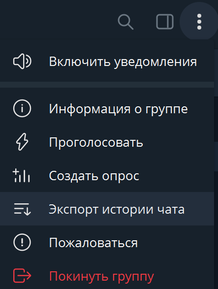

### Цель:

Научиться описывать сложные JSON-структуры в виде Rust-типов, использовать атрибуты `serde` для сопоставления полей и реализовать базовый анализ содержимого.

### Шаг 1. Исходные данные

В Telegram есть функция «Экспорт данных» (Три точки → Экспорт истории чата):



При экспорте чата в формате JSON появляется файл `result.json`, со структурой примерно такой:

```json
{
  "name": "My Chat",
  "messages": [
    {
      "id": 1,
      "from": "Alice",
      "date": "2025-09-01T10:00:00",
      "text": "Привет!"
    },
    ...
  ]
}
```

### Шаг 2. Задание

1. Описать структуры:

- `TgExport` в которую `serde` поместит обработанный экспорт истории чата.
- `Message` описывающую одно сообщение с необходимыми вами полями. Для простоты вы можете просто игнорировать ненужные вам поля.

2. Реализовать функцию чтения из файла, обрабатывая ошибки с помощью `anyhow`.
3. Реализовать простую аналитику:

- Количество сообщений.
- Список уникальных участников.
- Количество сообщений от каждого участника.
- Самое длинное сообщение.

4. Вывести результат в консоль в удобном и читаемом виде. Все ошибки должны быть обработаны и красиво напечатаны.

Дополнительные задачи:

- Экспорт отчета в машиночитаемый формат.
- Подсчет статистики по медиа, реакциям, и др.
- Поддержка фильтрации по диапазону дат.
- Обработка аргументов командной строки с помощью `clap`.

### Итог

В результате вы должны получить утилиту:

```bash
cargo run -- path/to/result.json
```

которая напечатает, например:

```
Чат: My Chat
Всего сообщений: 1573
Участники: Alice, Bob
Топ-3 по количеству сообщений:
1. Alice – 850
2. Bob   – 723
```
